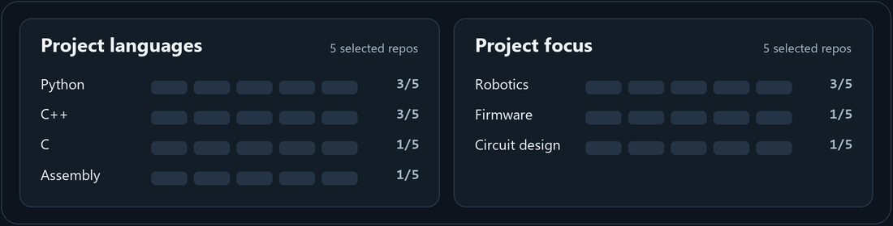

<picture>
  <source media="(prefers-reduced-motion: reduce)" srcset="assets/profile-graphs.webp">
  
</picture>

<!-- Technology icons from https://simpleicons.org/. -->

[LinkedIn](https://www.linkedin.com/in/muhammad-abdulhamid/) · [Email](mailto:muhammad.al.ajami.se@gmail.com) · [All repositories](https://github.com/Muhammad-296?tab=repositories)

### Selected projects

[Control Station](https://github.com/Muhammad-296/Control-Station) · [Mars Rover](https://github.com/Muhammad-296/Mars-Rover) · [Gesture-Controlled Car](https://github.com/Muhammad-296/Gesture-controlled-Car) 
[Digital Clock](https://github.com/Muhammad-296/Digital-Clock) · [CMOS Logic Analyzer](https://github.com/Muhammad-296/Elect_Proj)
